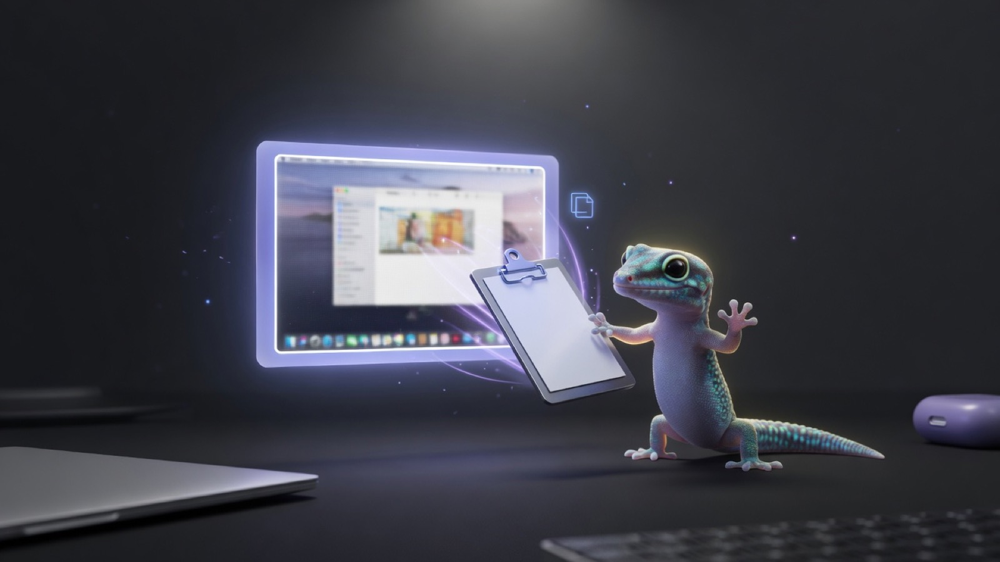

# clipboard-screenshot

<p align="center">
  
</p>

**Every new macOS screenshot is copied to your clipboard automatically.**

`⌘⇧3` / `⌘⇧4` → `⌘V`

macOS won’t save a file **and** put the image on the clipboard with the same shortcut. This fills that gap: your usual shortcuts still save a file; this tool copies that image to the pasteboard as soon as the file appears so you can paste.

Does **not** move, rename, or delete screenshots. Zero dependencies — `launchd`, `zsh`, `osascript`.

> A fork of [stevederico/clipboard-screenshot](https://github.com/stevederico/clipboard-screenshot) (MIT) with fixes for macOS Sequoia. See [Fork changes](#fork-changes).

## Install

```bash
git clone https://github.com/jeanpfs/clipboard-screenshot.git
cd clipboard-screenshot
./install.sh
```

No Full Disk Access. Install standardises your capture folder to **`~/Screenshots`**, which sits outside TCC scope, so the agent can list it directly instead of depending on Spotlight. Your previous location is saved and restored on uninstall.

### Uninstall

```bash
./uninstall.sh
```

Stops the agent, removes support files, and restores your previous screenshot location and floating-thumbnail setting. Your screenshots in `~/Screenshots` are left untouched.

## How it works

1. **launchd `WatchPaths`** — runs when your screenshot folder changes (FSEvents; not a poll loop).
2. Reads `defaults read com.apple.screencapture location-screenshot` — the per-mode key the `⌘⇧4` UI actually uses on Sequoia — falling back to the legacy `location` key, then `~/Desktop`.
3. Resolves the newest `Screenshot*` / `Screen Shot*` **directly in** that folder by listing it (~0.04 ms). Spotlight (`mdfind`) is consulted only when `readdir` is blocked by TCC. Nested copies under e.g. `projects/` are ignored.
4. Copies it to the pasteboard as **PNG** (via JXA / `osascript`) when mtime is newer than the last successful copy.
5. Notification: **Screenshot Ready** · Cmd+V to paste.

### Floating thumbnail

Install turns **off** the bottom-right screenshot preview. That UI delays writing the file to disk, so nothing can hit the clipboard until it goes away — and there’s no public API for the preview buffer. That setting is what makes paste feel instant. Uninstall restores your prior preference.

```bash
# turn the preview back on yourself
defaults write com.apple.screencapture show-thumbnail -bool true
killall SystemUIServer
```

## Control

```bash
# Logs
tail -f ~/Library/Application\ Support/com.stevederico.clipboard-screenshot/watcher.log

# Stop
launchctl bootout gui/$(id -u)/com.stevederico.clipboard-screenshot

# Start again
./install.sh
```

| | |
|---|---|
| Agent | **Clipboard Screenshot** (`com.stevederico.clipboard-screenshot`) |
| App / state | `~/Library/Application Support/com.stevederico.clipboard-screenshot/` |

## Requirements

- macOS (tested on Sequoia)
- Spotlight indexing on — only needed if you point the capture folder back inside a TCC-protected directory such as `~/Desktop`
- Default screenshot **names** (`Screenshot …` / `Screen Shot …`)
- Screenshot **type** PNG (macOS default) — clipboard copy uses PNG pasteboard data

## Built-in alternative

Clipboard only, no file: `⌘⌃⇧3` / `⌘⌃⇧4`.


## Fork changes

Measured on macOS 26 (Sequoia), M3 Max:

- **`⌘⇧4` captures were never detected.** Sequoia splits the capture-location preference per mode. The interactive UI reads `location-screenshot`; the legacy `location` key is honoured only by the `screencapture` CLI. The agent read `location` alone, so it watched a folder the UI never wrote to and the clipboard kept serving the previously copied image.
- **A fruitless retry loop took ~30 s** and held the lock, so the next screenshot's event was dropped at `(( got_lock )) || exit 0`. Discovery is now ordered by measured cost — directory listing (0.04 ms) before Spotlight (~700 ms from the launchd agent) — and the System Events fallback runs once after the loop instead of on all 40 attempts. Now ~5 s.
- **Screenshots taken in the same second as the previous one were dropped.** `stat -f %m` is whole-second, so `mtime > last` failed. Now uses `%Fm` (nanoseconds).
- **A stale Spotlight result masked every fallback.** From the launchd agent, `mdfind` on a TCC-protected folder returned a permanently stale view — listing a deleted file while omitting the newest one.
- Watches only the configured location; also watching `~/Desktop` woke the agent on unrelated changes and caused lock contention.
- Support directory is `700`; uninstall refuses to `rm -rf` a `CLIPBOARD_SCREENSHOT_HOME` outside its own bundle id, and restores both location keys.

## License

[MIT](LICENSE) © Steve Derico
